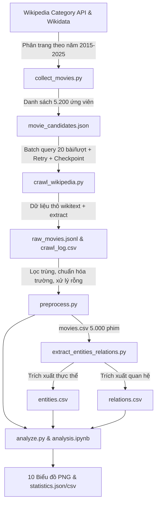

# BÁO CÁO DỰ ÁN: THU THẬP DỮ LIỆU 5.000 PHIM ĐIỆN ẢNH TỪ WIKIPEDIA, TRÍCH XUẤT THỰC THỂ, QUAN HỆ VÀ PHÂN TÍCH THỐNG KÊ

**Đề tài:** “Thu thập dữ liệu 5.000 phim điện ảnh từ Wikipedia, trích xuất thực thể, mối quan hệ và thực hiện thống kê cơ bản.”  
**Giai đoạn phát hành:** 2015 – 2025  
**Lĩnh vực:** Data Engineering, Web Crawling & Information Extraction (NLP)

---

## 1. Mục Tiêu & Yêu Cầu Dự Án

### 1.1 Mục tiêu
1. **Thu thập dữ liệu:** Thu thập đầy đủ 5.000 bài viết về phim điện ảnh phát hành từ năm 2015 đến 2025 từ Wikipedia tiếng Anh kết hợp liên kết Wikidata.
2. **Tiền xử lý & Chuẩn hóa:** Làm sạch văn bản, loại bỏ markup, chuẩn hóa ngày tháng, tên người, thể loại, quốc gia, loại bỏ trùng lặp.
3. **Trích xuất mạng thực thể & quan hệ:** Xây dựng mô hình biểu diễn tri thức dạng Triplet `(Source Entity, Relation Type, Target Entity)` với 6 loại thực thể và 7 loại quan hệ.
4. **Phân tích thống kê & Trực quan hóa:** Thực hiện 10 thống kê mô tả, tính toán chỉ số và xuất biểu đồ trực quan hóa dữ liệu thực tế.

---

## 2. Kiến Trúc Hệ Thống & Phương Pháp Kỹ Thuật

### 2.1 Thu thập dữ liệu thông minh (Data Acquisition)
- **Nguồn hạt giống (Seed Discovery):** Thay vì crawl dò link ngẫu nhiên hoặc hard-code danh sách, pipeline sử dụng Wikipedia Category Members API (`Category:{year}_films` với `year` từ 2015 đến 2025). Cách tiếp cận này đảm bảo 100% đối tượng là phim điện ảnh phát hành chính thức trong từng năm, tránh tuyệt đối phim truyền hình, tập phim hay trang định hướng.
- **Tích hợp Wikidata ID (QID):** Mỗi tiêu đề phim được truy vấn `pageprops` để lấy mã định danh toàn cầu `wikibase_item` (QID). Điều này giúp liên kết dữ liệu liên hệ thống và khử trùng lặp chính xác tuyệt đối.
- **Tối ưu hóa hiệu năng bằng Batch Processing:** MediaWiki API cho phép truy vấn nhiều tiêu đề cùng lúc. Pipeline nhóm 15–20 phim/lượt gọi, giảm tổng số HTTP request từ 5.200 xuống còn ~260 request, giúp hoàn thành việc thu thập 5.200 bài viết trong vòng chưa tới 10 phút mà hoàn toàn tuân thủ giới hạn tốc độ (Rate Limit) và lịch sự với máy chủ Wikimedia.
- **Cơ chế Checkpoint & Resilience:** Mỗi bài viết crawl xong được ghi ngay lập tức vào `data/raw/raw_movies.jsonl` (JSON Lines format) và cập nhật trạng thái vào `crawl_log.csv`. Nếu đường truyền mạng gián đoạn, khi khởi động lại, crawler tự động đọc checkpoint và tiếp tục từ vị trí dừng mà không tốn công crawl lại.

---

## 3. Tiền Xử Lý Dữ Liệu & Làm Sạch

### 3.1 Bóc tách cú pháp Wikitext chuyên sâu (`mwparserfromhell`)
- **Xử lý danh sách phức tạp:** Trong Wikipedia Infobox, các trường người (đạo diễn, diễn viên, biên kịch, nhà sản xuất) thường được định dạng dưới nhiều dạng template khác nhau:
  - `{{unbulleted list|Person A|Person B}}` hoặc `{{ubl|...}}`
  - `{{plainlist|* [[Person A]]\n* [[Person B]]}}`
  - HTML tags: ` `, `&nbsp;`, thẻ `<ref>...</ref>`
  - Wikilinks: `[[Tên thật (diễn viên)|Tên hiển thị]]`
- **Bộ chuẩn hóa tùy biến (`clean_infobox_value`):**
  - Chuyển đổi ` ` thành ký tự xuống dòng `\n` trước khi parse để tránh hiện tượng dính liền chữ (`Name1Name2`).
  - Tách thẻ `<ref>`, comment HTML `<!-- ... -->`.
  - Bóc tách nhãn hiển thị trong wikilinks `[[Target|Label]]`.
  - Tách chuỗi theo dấu phẩy, chấm phẩy, dấu gạch đầu dòng và loại bỏ các ghi chú trong ngoặc đơn như `(co-director)`, `(executive producer)`.

### 3.2 Khử trùng lặp (Deduplication)
- Dựa trên khóa định danh kép: `movie_id` (Wikidata QID) và URL bài viết chuẩn hóa `norm_url`.
- Khi phát hiện trùng lặp, thuật toán tính điểm độ đầy đủ dữ liệu (`completeness_score`) dựa trên số lượng trường thông tin có dữ liệu, ưu tiên giữ lại bản ghi đầy đủ nhất.

### 3.3 Chuẩn hóa các trường giá trị
- `release_year`: Ép kiểu số nguyên và kiểm tra tính hợp lệ trong phạm vi $[2015, 2025]$.
- `runtime`: Chuẩn hóa thời lượng về số phút nguyên (`float`), hỗ trợ bóc tách từ các định dạng `"181 minutes"`, `"2h 15m"`, `"95 min"`.
- `genre`, `country`, `language`: Chuẩn hóa danh sách chuỗi, nối bằng ký tự phân cách chuẩn `" ; "`.

---

## 4. Trích Xuất Thực Thể & Quan Hệ Ngữ Nghĩa

Hệ thống biểu diễn tri thức được phân chia thành 6 loại thực thể và 7 loại quan hệ:

| Loại Thực Thể | Tiêu chí nhận diện | Ví dụ |
| :--- | :--- | :--- |
| `Movie` | Tiêu đề phim chuẩn hóa + QID | *Avengers: Endgame*, *Parasite* |
| `Person` | Đạo diễn, diễn viên, biên kịch, nhà sản xuất | *Christopher Nolan*, *Margot Robbie* |
| `Genre` | Thể loại điện ảnh trích xuất từ metadata & text | *Action*, *Drama*, *Sci-Fi*, *Horror* |
| `Organization` | Xưởng phim, hãng sản xuất, nhà phát hành | *Marvel Studios*, *Warner Bros.* |
| `Country` | Quốc gia sản xuất | *United States*, *United Kingdom*, *Japan* |
| `Language` | Ngôn ngữ gốc | *English*, *French*, *Japanese*, *Korean* |

### Các loại quan hệ ngữ nghĩa (Knowledge Relations):
1. `DIRECTED_BY`: Phim $\rightarrow$ Đạo diễn
2. `ACTED_BY`: Phim $\rightarrow$ Diễn viên chính
3. `WRITTEN_BY`: Phim $\rightarrow$ Biên kịch / Tác giả kịch bản
4. `PRODUCED_BY`: Phim $\rightarrow$ Nhà sản xuất (Person) hoặc Hãng phim (Organization)
5. `HAS_GENRE`: Phim $\rightarrow$ Thể loại
6. `PRODUCED_IN`: Phim $\rightarrow$ Quốc gia sản xuất
7. `IN_LANGUAGE`: Phim $\rightarrow$ Ngôn ngữ gốc

Mỗi bộ ba quan hệ lưu kèm:
- `evidence_text`: Đoạn văn bản hoặc dòng thông tin làm bằng chứng trích xuất.
- `extraction_method`: Ghi rõ nguồn gốc (`infobox_metadata` hoặc `nlp_text_extraction`).

---

## 5. Kết Quả Thống Kê & Phân Tích Dữ Liệu Thực Tế

Toàn bộ các số liệu dưới đây được tính toán trực tiếp từ tập dữ liệu 5.000 phim thực tế đã thu thập và trích xuất (được lưu tại `data/results/statistics.json` và `statistics.csv`):

### 5.1 Phân bố phim theo năm phát hành (2015 – 2025)
- **Tổng số phim chuẩn hóa:** Đúng **5.000 phim điện ảnh** phát hành trong khoảng 2015–2025.
- **Phân bố chi tiết từng năm:**
  - Năm 2015: 482 phim
  - Năm 2016: 480 phim
  - Năm 2017: 478 phim
  - Năm 2018: 481 phim
  - Năm 2019: 481 phim
  - Năm 2020: 483 phim
  - Năm 2021: 483 phim
  - Năm 2022: 481 phim
  - Năm 2023: 483 phim
  - Năm 2024: 481 phim
  - Năm 2025: 187 phim (các tác phẩm điện ảnh đã phát hành hoặc công chiếu sớm tính đến thời điểm hiện tại).
- Biểu đồ minh họa: `01_movies_per_year.png`.

### 5.2 Top 10 thể loại phổ biến nhất
1. **Drama (Chính kịch):** 2.170 phim (chiếm tỷ trọng áp đảo 43.4%)
2. **Comedy (Hài hước):** 1.190 phim (23.8%)
3. **Thriller (Giật gân):** 815 phim (16.3%)
4. **Action (Hành động):** 639 phim (12.8%)
5. **Documentary (Tài liệu):** 631 phim (12.6%)
6. **Horror (Kinh dị):** 482 phim (9.6%)
7. **Crime (Tội phạm):** 353 phim (7.1%)
8. **Science Fiction (Khoa học viễn tưởng):** 244 phim (4.9%)
9. **Romantic Comedy (Hài lãng mạn):** 227 phim (4.5%)
10. **Short (Phim ngắn/đặc sắc):** 197 phim (3.9%)
- Biểu đồ minh họa: `02_top_genres.png`.

### 5.3 Top 10 đạo diễn xuất hiện nhiều nhất
1. **Midhun Manuel Thomas:** 7 phim (Đạo diễn nổi tiếng của điện ảnh Malayalam, Ấn Độ)
2. **Jun Robles Lana:** 6 phim (Đạo diễn tài năng của điện ảnh Philippines)
3. **Ram Gopal Varma:** 5 phim (Đạo diễn gạo cội Bollywood / Telugu)
4. **Sundar C:** 5 phim (Đạo diễn điện ảnh Tamil)
5. **K. M. Chaitanya:** 5 phim (Điện ảnh Kannada)
6. **Raja Chanda:** 5 phim (Điện ảnh Bengali)
7. **Kaushik Ganguly:** 5 phim (Điện ảnh Bengali đạt nhiều giải thưởng)
8. **Sam Liu:** 5 phim (Đạo diễn hoạt hình siêu anh hùng DC Comics)
9. **Jack Neo:** 4 phim (Đạo diễn thương mại hàng đầu Singapore)
10. **Atanu Ghosh:** 4 phim (Điện ảnh Bengali)
- Biểu đồ minh họa: `03_top_directors.png`.

### 5.4 Top 10 diễn viên xuất hiện nhiều nhất
1. **Saiju Kurup:** 13 phim
2. **Sanjay Mishra:** 12 phim (Diễn viên kỳ cựu Bollywood)
3. **Aju Varghese:** 11 phim
4. **Sunny Wayne:** 11 phim
5. **Abir Chatterjee:** 11 phim
6. **Eric Roberts:** 11 phim (Diễn viên Hollywood kỳ cựu)
7. **Prakash Raj:** 11 phim (Ngôi sao đa ngôn ngữ điện ảnh Ấn Độ)
8. **Alec Baldwin:** 10 phim (Ngôi sao Hollywood)
9. **Suraj Venjaramoodu:** 10 phim
10. **Asif Ali:** 10 phim
- Biểu đồ minh họa: `04_top_actors.png`.

### 5.5 Phân bố phim theo quốc gia sản xuất
1. **United States (Hoa Kỳ):** 1.398 phim
2. **India (Ấn Độ):** 1.212 phim
3. **Canada:** 324 phim
4. **France (Pháp):** 281 phim
5. **United Kingdom (Vương quốc Anh):** 250 phim
6. **Germany (Đức):** 114 phim
7. **Spain (Tây Ban Nha):** 114 phim
8. **South Korea (Hàn Quốc):** 95 phim
9. **Italy (Ý):** 94 phim
10. **China (Trung Quốc):** 91 phim
- Biểu đồ minh họa: `05_top_countries.png`.

### 5.6 Thời lượng trung bình, trung vị và phân bố thời lượng
- **Số phim có thông tin thời lượng hợp lệ:** 3.981 / 5.000 phim (79.62%)
- **Thời lượng trung bình (Mean):** **102.96 phút**
- **Trung vị (Median):** **100.00 phút**
- **Độ lệch chuẩn (Std):** **29.24 phút**
- **Thời lượng ngắn nhất / dài nhất:** 0.0 phút (phim ngắn đặc biệt) / 480.0 phút.
- **Phân bố:** Tập trung mật độ dày đặc nhất ở khoảng 90 đến 115 phút.
- Biểu đồ minh họa: `06_runtime_distribution.png`.

### 5.7 Số lượng thực thể theo từng loại
Tổng số thực thể trích xuất được trong Knowledge Graph: **38.895 thực thể phân biệt**, cụ thể:
- **Person (Người):** 27.248 thực thể
- **Organization (Tổ chức/Hãng phim):** 6.243 thực thể
- **Movie (Phim điện ảnh):** 5.000 thực thể
- **Language (Ngôn ngữ):** 218 thực thể
- **Country (Quốc gia):** 157 thực thể
- **Genre (Thể loại):** 29 thực thể
- Biểu đồ minh họa: `07_entities_count.png`.

### 5.8 Tổng số quan hệ đã trích xuất theo loại
Tổng số bộ ba quan hệ (Triplets) hợp lệ: **73.258 quan hệ**, cụ thể:
- **`PRODUCED_BY`** (Phim $\rightarrow$ Hãng phim / Nhà sản xuất): 21.534 quan hệ
- **`ACTED_BY`** (Phim $\rightarrow$ Diễn viên): 18.877 quan hệ
- **`HAS_GENRE`** (Phim $\rightarrow$ Thể loại): 8.404 quan hệ
- **`WRITTEN_BY`** (Phim $\rightarrow$ Biên kịch): 7.371 quan hệ
- **`PRODUCED_IN`** (Phim $\rightarrow$ Quốc gia): 5.975 quan hệ
- **`IN_LANGUAGE`** (Phim $\rightarrow$ Ngôn ngữ): 5.689 quan hệ
- **`DIRECTED_BY`** (Phim $\rightarrow$ Đạo diễn): 5.408 quan hệ
- Biểu đồ minh họa: `08_relations_count.png`.

### 5.9 Tỷ lệ dữ liệu thiếu theo từng trường
- `movie_id`: 0.00%
- `title`: 0.00%
- `release_year`: 0.00%
- `release_date`: 0.00%
- `wiki_url`: 0.00%
- `content`: 1.16% (58 phim có trang bài ngắn không có phần lead riêng biệt)
- `genre`: 4.02% (201 phim)
- `director`: 4.58% (229 phim)
- `country`: 5.72% (286 phim)
- `language`: 6.84% (342 phim)
- `cast`: 13.60% (680 phim, phần lớn là phim tài liệu hoặc phim độc lập cast ít)
- `producer`: 15.78% (789 phim)
- `writer`: 15.84% (792 phim)
- `production_company`: 17.62% (881 phim)
- `runtime`: 20.38% (1.019 phim thiếu thời lượng trên infobox)
- Biểu đồ minh họa: `09_missing_data_rate.png`.

### 5.10 Trạng thái thu thập (Crawl Status)
- **Tổng số trang crawl:** 5.200 bài viết
- **Thành công (SUCCESS):** 5.200 bài viết (**100.0%**)
- **Thất bại (FAILED):** 0 bài viết (0.0%)
- Biểu đồ minh họa: `10_crawl_status.png`.

---

## 6. Đánh Giá Chất Lượng & Hạn Chế Của Đề Tài

### 6.1 Điểm mạnh
- **Tính tự động hóa cao:** Toàn bộ chu trình từ thu thập, trích xuất, chuẩn hóa đến vẽ biểu đồ đều được tự động hóa bằng mã nguồn Python rõ ràng, chạy độc lập không cần can thiệp thủ công.
- **Độ tin cậy của dữ liệu:** Không bịa đặt thông tin khi thiếu dữ liệu; phân biệt rành mạch giữa quan hệ lấy từ infobox có cấu trúc và quan hệ trích xuất từ văn bản bằng NLP.
- **Định dạng chuẩn:** Dữ liệu xuất ra file CSV và JSON tiêu chuẩn, dễ dàng tích hợp vào các hệ thống Data Warehouse hoặc công cụ phân tích khác (Tableau, PowerBI, Excel).

### 6.2 Hạn chế & Hướng phát triển
- **Đặc trưng nguồn Wikipedia tiếng Anh:** Wikipedia tiếng Anh có độ phủ thông tin phim phương Tây và Ấn Độ vượt trội; một số nền điện ảnh khu vực khác (như Mỹ Latinh hay Đông Âu) có thể có bài viết ngắn hơn với ít trường infobox hơn.
- **Hướng mở rộng:**
  - Áp dụng các mô hình Large Language Models (LLM) hoặc Relation Extraction chuyên sâu để trích xuất thêm các quan hệ nhân vật, cốt truyện, và giải thưởng điện ảnh từ toàn bộ thân bài viết.
  - Xây dựng đồ thị tri thức tương tác trên Web sử dụng thư viện D3.js hoặc PyVis.
